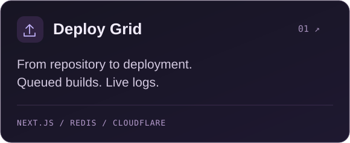
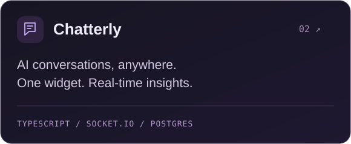

  I build thoughtful software for real problems. 
  Exploring reliable systems, deployment pipelines, and open source.

  
  
  
  

### Things I've built

  
  

### My toolkit

  

### One commit at a time

<picture>
  <source media="(prefers-color-scheme: dark)" srcset="https://raw.githubusercontent.com/aadithya2112/aadithya2112/output/github-snake-dark.svg" />
  <source media="(prefers-color-scheme: light)" srcset="https://raw.githubusercontent.com/aadithya2112/aadithya2112/output/github-snake.svg" />
  
</picture>
